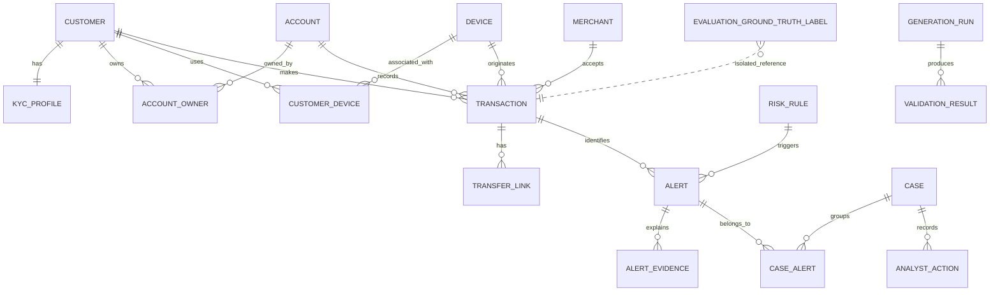

# RiskLens AI

RiskLens is a focused, explainable transaction-risk operations prototype. It includes a deterministic synthetic-data pipeline, a rule-based alert model, authenticated analyst APIs, case dispositions with immutable audit events, and a responsive React analyst console.

# Login credentials For Testing
mail to log: risklens.ai@gmail.com
password:    Harsha@202630

## What is implemented

- **Generator:** deterministic Phase 2 exports for 5,000 customers, 7,000 accounts, 500 merchants, 3,000 devices, 100,000 transactions, 1,000 alerts, isolated ground truth, negative fixtures, SQL exports, and checksums.
- **Validation:** structural, referential, financial, temporal, risk, ground-truth, and negative-fixture checks with calculated precision, recall, F1, false-positive rate, and scenario coverage.
- **API:** PostgreSQL-backed health, JWT login, overview/evaluation metrics, paginated operational resources, transaction risk assessment with idempotent alert persistence, alert lifecycle events, case assignment/status/disposition/comments, audit history, validation results, generation runs, and administrator user listing.
- **Database architecture:** PostgreSQL/Prisma is the primary runtime path. SQLite remains an explicitly selectable legacy adapter for compatibility and isolated tests.
- **UI:** login, overview metrics, alert volume chart, evaluation quality, alert queue, investigation drawer, and sign out. All operational data is loaded from the API.

## Run locally

```powershell
npm install
npm --prefix backend install
npm --prefix frontend install
python -m generator.generate --mode sample --seed 42 --output data/phase2-sample
python -m generator.validate --input data/phase2-sample
npm run dev
```

Open `http://localhost:5173` and use an administrator-provisioned, activated account.
New registrations are created as `PENDING` and cannot authenticate until activated.

## Tests and builds

```powershell
npm --prefix backend test
npm run build
```

The PostgreSQL integration test is opt-in and requires both `DATABASE_URL` and
`RUN_POSTGRES_INTEGRATION_TESTS=true`; ordinary backend test runs use isolated
SQLite test databases and do not write to Supabase.

## Database modes

### SQLite legacy mode

SQLite is an explicit legacy mode:

```powershell
$env:DATABASE_MODE = "sqlite"; npm --prefix backend run dev
```

The existing database is `backend/risklens.db`, or the path set with `RISKLENS_DB`.
SQLite startup applies idempotent, transactional migrations recorded in
`_risklens_migrations`; the authentication version is incremented whenever an
account status, role, or password changes so existing JWTs are invalidated.

SQLite is retained only for legacy compatibility. PostgreSQL authentication uses the additive
[0003_user_auth_version migration](./backend/prisma/migrations/0003_user_auth_version/migration.sql)
to apply the same token-version invalidation model. The PostgreSQL adapter is
prepared for the controlled PostgreSQL runtime.

### PostgreSQL / Prisma mode

PostgreSQL is the default non-test runtime and configuration is supplied through
environment variables. Never commit a real connection string:

```powershell
Copy-Item backend\.env.postgres.example backend\.env
npm --prefix backend run db:generate
npm --prefix backend run db:validate
```

The PostgreSQL API requires a reachable database with the authorized migrations
already applied. Migration deployment and data import are separate controlled
operations; the application does not run either automatically. The Prisma client
is used by `backend/src/postgres-server.ts`, while `backend/src/sqlite-server.ts`
is loaded only for explicit legacy mode or tests.

Production deployments should use [backend/.env.production.example](./backend/.env.production.example) as a variable template, inject secrets through the hosting provider, and set a random `JWT_SECRET` of at least 32 characters. The old demo-password flow has been removed.

## Database architecture

Operational data is stored in the `public` PostgreSQL schema. Ground-truth evaluation labels are stored in the separate `evaluation` schema and have no Prisma relation to operational models, preventing the operational risk path from querying labels accidentally.

Core relationships:

- `Customer` has one `KYCProfile`, many historical `AccountOwner` records, many `CustomerDevice` records, transactions, and alerts.
- `Account` has historical owners, transactions, transfer source/target legs, account events, and alerts.
- `Transaction` optionally references a `Merchant` and `Device`; `TransferLink` connects transfer legs to source and target accounts.
- `RiskRule` is versioned by `(ruleCode, version)` and is referenced by alerts.
- `Alert` references a customer, account, transaction, and rule; evidence and lifecycle events are append-only child records.
- `CaseAlert` groups alerts into cases; `AnalystAction` and `CaseEvent` preserve workflow history.
- `AuditEvent` records cross-entity history without foreign keys to arbitrary business IDs.
- `GenerationRun` owns `ValidationResult` records for reproducible pipeline runs.



The canonical schema is [backend/prisma/schema.prisma](./backend/prisma/schema.prisma), and the initial PostgreSQL migration is [backend/prisma/migrations/0001_initial_postgresql/migration.sql](./backend/prisma/migrations/0001_initial_postgresql/migration.sql).

Historical records in `audit_events`, `account_events`, `alert_events`,
`case_events`, and `analyst_actions` are protected by PostgreSQL
`BEFORE UPDATE OR DELETE` triggers in the initial migration. Inserts remain
available for normal event recording; corrections must be represented by a
new event rather than mutating an existing row.

## Phase 2 data generation

The generator is export-only and never opens SQLite or PostgreSQL. It uses a fixed
reference timestamp, deterministic UUIDs, stable ordering, and a configurable seed.
Ground truth is written only under `evaluation/`; invalid records are written only
under `negative-fixtures/`.

```powershell
python -m generator.generate --mode sample --seed 42 --output data/phase2-sample
python -m generator.validate --input data/phase2-sample
python -m generator.generate --mode full --seed 42 --output data/phase2-full
python -m generator.validate --input data/phase2-full
```

Each output contains operational CSV/JSON exports, `operational.sql`, an
evaluation ground-truth export, five negative fixtures, a generation manifest,
validation and evaluation reports, scenario documentation, a data dictionary,
and per-entity checksums. The full fixed volumes are 5,000 customers, 7,000
accounts, 500 merchants, 3,000 devices, 100,000 transactions, and 1,000 alerts.
Run the same command and compare `generation-manifest.json` checksums to verify
reproducibility. The SQL export is insert-only and is not applied automatically.
Circular-transfer groups use deterministic seeded canonical amounts in the
synthetic $10.00-$25.00 range; both legs and their transactions share the
same amount and currency, with reciprocal account endpoints.
Generated analyst users are inert provisioning records: they are `PENDING`,
contain unique unusable password markers, and must be replaced or explicitly
activated through secure account provisioning before production access.

The nine versioned rules are R001 velocity spike, R002 new device activity,
R003 circular transfer, R004 dormant reactivation, R005 closed-account attempt,
R006 negative-balance attempt, R007 transfer reconciliation, R008 unusual
merchant activity, and R009 repeated suspicious attempts. Scores are capped at
100 and mapped to LOW (0-24), MEDIUM (25-49), HIGH (50-74), and CRITICAL
(75-100). Legitimate high-value and benign-unusual scenarios remain in the
ground truth as non-suspicious examples.

Evaluation is transaction-based: alert transaction IDs are matched exactly to
ground-truth transaction IDs, duplicate alerts count once, and unmatched
transactions contribute to false negatives or true negatives. Metrics are
calculated from generated records rather than hardcoded.

## API

- `GET /health`
- `POST /api/auth/login`
- `GET /api/overview` (includes data-driven evaluation metrics in PostgreSQL mode)
- `GET /api/alerts`, `GET /api/alerts/:id`
- `GET /api/cases`, `POST /api/cases`
- `POST /api/cases/:id/disposition`
- `GET /api/customers`
- `GET /api/customers/:id`
- `GET /api/accounts`
- `GET /api/accounts/:id`
- `GET /api/transactions`
- `GET /api/transactions/:id`
- `POST /api/risk/assess/:id`
- `POST /api/risk/batch`
- `POST /api/risk/batch/:runId/evaluate`
- `POST /api/alerts/:id/status`
- `PATCH /api/cases/:id`
- `GET /api/rules`
- `GET /api/audit`
- `GET /api/validation`
- `GET /api/generation-runs`
- `GET /api/users` (administrator only)
- `PATCH /api/users/:id/provision` (administrator only)
- `POST /api/admin/bootstrap` (one-time, requires external `ADMIN_BOOTSTRAP_SECRET`)

All `/api/*` routes except login and registration require `Authorization: Bearer <token>`. Set a strong `JWT_SECRET` and `FRONTEND_ORIGIN` in production.

### Account provisioning

New and generated accounts remain `PENDING` and cannot authenticate. A trusted
administrator must create or securely provision a unique password, verify the
account owner through an out-of-band process, then activate the account through
an authorized backend workflow. Provisioning markers in generated exports are
not passwords and must never be converted into login credentials. Password
hashes and evaluation labels are never returned by public API endpoints.

### PostgreSQL import preparation

`python -m generator.import_postgres --input data/phase2-full` performs a
read-only dry run. It verifies manifest checksums, entity counts, UUIDs,
Decimal(18,2) values, timestamps, JSON, enums, foreign keys, duplicate keys,
insertion order, and isolation of evaluation and negative-fixture data.
Execution requires explicit `--execute --confirm-import` flags and uses
separate atomic transactions for operational and evaluation data. It was not
executed as part of dataset preparation.

## Known limitations

Migration execution and data import remain controlled external operations and
were not performed by this implementation sprint. Full CRUD administration,
advanced case grouping, Swagger, deployment manifests, and real-time rule
authoring remain outside the current challenge slice. PostgreSQL integration
tests still require an explicitly configured disposable PostgreSQL instance.
